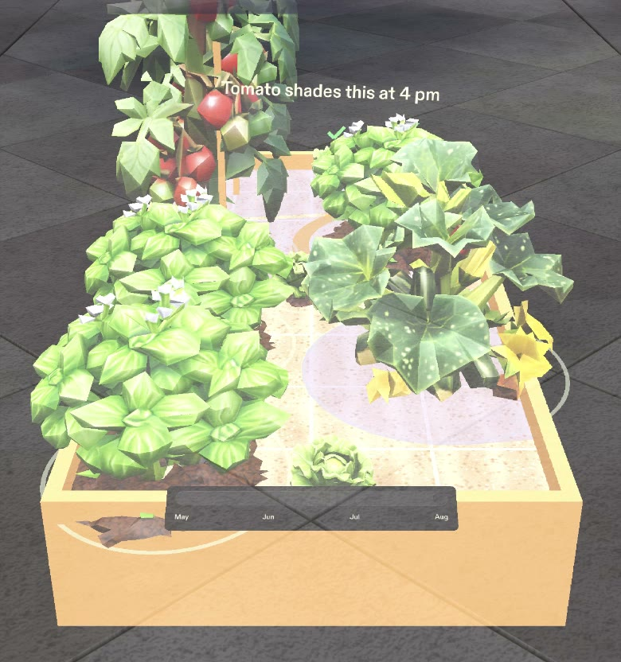

# Plot Twist: see your garden in August before you plant it in May

A Lens for SPECS for first-time vegetable gardeners. You stand at your new raised bed, drop in seedlings, and drag one slider from May to August. Every plant grows to its real full size in the soil, so you see the zucchini swallow the basil before it happens, and you fix it while it's still a seedling.

**Demo video:** _YouTube link_

## The moment

The seed packet says "space 24 in." With dirt on your hands that number means nothing. Plot Twist turns it into the plant itself, at real size, in the bed you're looking at:

1. **Plant.** Pinch a seed packet and drag. A ghost seedling and its spacing ring follow your hand; let go and it's in.
2. **Scrub to August.** One slider along the bed's rim. Every plant grows to its real August height and footprint.
3. **See the twist.** Only in August, only on the plant in trouble: an amber ring and one line, "Zucchini covers this by July" or "Tomato shades this at 4 pm". Lettuce in the tomatoes' shade gets a green tick instead, because afternoon shade keeps it from bolting.
4. **Fix it.** Drag the basil to the sunny end. The ring turns green.
5. **Plant it.** One dig spot at a time, with the plant's name and depth, and one big Done button. Your hands stay in the soil.

## Why glasses

- **It draws in the world:** plants, footprints and shade sit in your bed at real size.
- **It leaves your body free:** you're kneeling with dirty hands, and a pinch is all it takes.
- **It shares your view:** it's your bed, seen from where you stand.

In May the bed is just a bed: no rings, no labels. Problems appear only in August, one at a time, on the plant they're about. Shade is light lavender, because dark colours vanish on an additive display.

## The numbers are real

| Crop | August height | Footprint (in-row spacing) | Sources |
|---|---|---|---|
| Tomato (indeterminate) | 122 cm | 61 cm | University of Minnesota Extension, University of Maryland Extension |
| Zucchini | 61 cm | 76 cm | University of Maryland Extension, NC State Plant Toolbox, Clemson HGIC |
| Basil | 46 cm | 61 cm | University of Maryland Extension, Clemson HGIC, University of Illinois Extension |
| Leaf lettuce | 15 cm | 20 cm | University of Maryland Extension, Clemson HGIC |

Shade uses NOAA's solar position equations for 15 August at 4 pm solar time and 40°N. The sun sits 32° above the horizon at azimuth 262°, so a shadow is 1.6 times the plant's height and falls east-northeast. Every number, with its source URL and quote, is in [`docs/plant-data.json`](docs/plant-data.json).

## How it was made

- **Planned** with the Devpost Learn skill pack (`npx skills add challengepost/learn-specs`). The `plan-lens` interview produced [`devpost/design-brief.md`](devpost/design-brief.md); the conversation is in [`devpost/planning-session.md`](devpost/planning-session.md).
- **Built** by Claude Code with Snap's CLAD plugin (`ls-clad`), driving Lens Studio 5.23.2 through the Lens Studio MCP. CLAD generated the four plant models, the sounds and the Spectacles UI Kit controls, and wrote the TypeScript for growth, crowding, shade and planting (`Assets/Scripts/PlotTwist*.ts`).
- **Tested** with LEAF, one scenario per done criterion (`Assets/Tests/`):

| Done criterion | LEAF scenario |
|---|---|
| Drag a packet onto the soil to plant a seedling with its spacing ring | `c1-plant-from-packet` |
| Slider May to August grows every plant to its real size | `c2-grow-to-august` |
| Basil inside the zucchini's footprint gets an amber ring and a warning; moving it clears it | `c3-crowding-warning` |
| 4 pm shade in July and August: basil warned, lettuce ticked | `c4-shade-patch` |
| Plant it: one dig spot at a time, Done, then "Your bed is planted" | `c5-planting-mode` |

`demo-full-run` plays the whole experience at human pace. It's the uncut run in the video.

## Run it

1. Open `PlotTwist.esproj` in Lens Studio 5.23.2 or later.
2. In the Preview panel choose Interactive Preview with the SPECS device. The video uses the "Sunlit Outdoor" scene.
3. Look down at the bed (right-drag or hold Shift), move with WASD, and click to pinch. Or open the LEAF panel and run `demo-full-run`.

## What's real

| Part | Status |
|---|---|
| Plant sizes, spacing, depths and the sun angle | Real, from the sources above |
| Growth, crowding, shade and planting logic | Built, tested with LEAF in the preview |
| Your bed and seed packets | Stand-ins: a virtual bed at real size and grabbable packets |
| Recognising a real bed or packet by camera; other dates and latitudes | Not built |
